

  

  
  
  
  
  
  

<h3>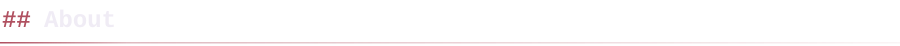</h3>

I'm Axel, an 18-year-old cybersecurity student at **Oteria**. My focus is offensive security: getting a first foothold through a web application, escalating privileges on the host, then moving through an Active Directory environment.

I train on Hack The Box and Root-Me, play CTFs, and write up what I learn on [my blog](https://uramix2.github.io). Cryptography is my hobby on the side, and it is where my research project TF-Cipher lives.

<h3>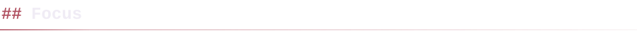</h3>

  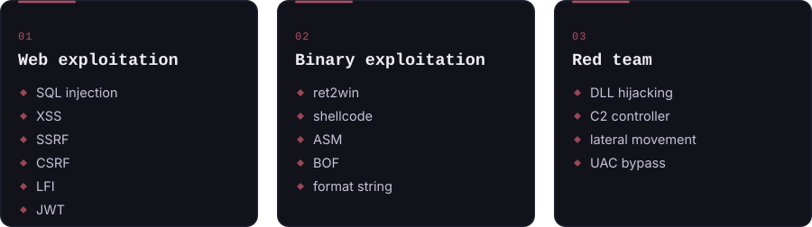

Also binary exploitation: buffer overflows, shellcode, ret2win, ROP, format strings.

<h3>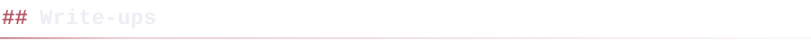</h3>

  <a href="https://uramix2.github.io/posts/tf-cipher/">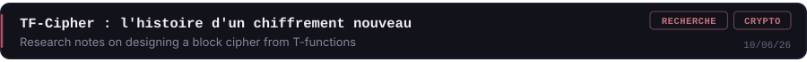</a>
  <a href="https://uramix2.github.io/posts/pwn-project-ftp/">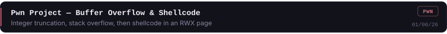</a>
  <a href="https://uramix2.github.io/posts/this-is-fine/">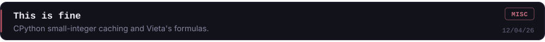</a>
  <a href="https://uramix2.github.io/posts/secure-aes-write-up/">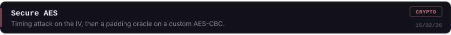</a>
  <a href="https://uramix2.github.io/posts/cnc-crypto-write-up/">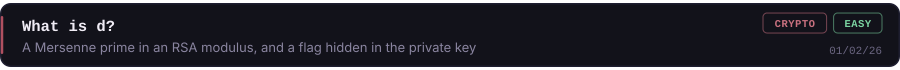</a>

<h3>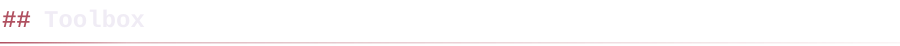</h3>

  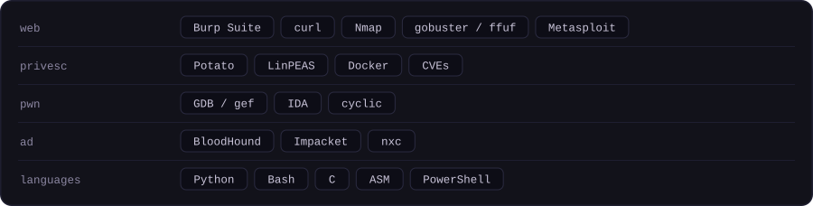

  

