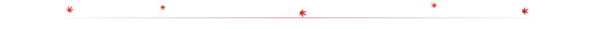

  

  
  
  
  
  
  

## About

I'm Axel, an 18-year-old cybersecurity student at **Oteria**. My focus is offensive security: getting a first foothold through a web application, escalating privileges on the host, then moving through an Active Directory environment.

I train on Hack The Box and Root-Me, play CTFs, and write up what I learn on [my blog](https://uramix2.github.io). Cryptography is my hobby on the side, and it is where my research project TF-Cipher lives.

## Focus

<table>
  <tr>
    <td valign="top" width="33%">
      <h3>Web exploitation</h3>
      

        SQL injection 
        XSS 
        SSRF 
        SSTI 
        Authentication bypass
      

    </td>
    <td valign="top" width="33%">
      <h3>Privilege escalation</h3>
      

        Linux enumeration 
        SUID and capabilities abuse 
        Kernel exploits 
        Misconfigured services
      

    </td>
    <td valign="top" width="33%">
      <h3>Active Directory</h3>
      

        Domain enumeration 
        Kerberoasting, AS-REP roasting 
        Credential abuse 
        Lateral movement
      

    </td>
  </tr>
</table>

Also: binary exploitation (buffer overflows, shellcode, ret2win, ROP, format strings).

## Write-ups

| | |
|---|---|
| [Pwn Project — Buffer Overflow & Shellcode](https://uramix2.github.io/posts/pwn-project-ftp/) | Integer truncation into a stack overflow, then shellcode in an RWX page to get around NX |
| [Secure AES](https://uramix2.github.io/posts/secure-aes-write-up/) | Timing attack to recover the IV, then a padding oracle on a custom AES-CBC |
| [This is fine](https://uramix2.github.io/posts/this-is-fine/) | CPython small-integer caching and Vieta's formulas |
| [What is d?](https://uramix2.github.io/posts/cnc-crypto-write-up/) | A Mersenne prime in an RSA modulus, and a flag hidden in the private key |
| [TF-Cipher](https://uramix2.github.io/posts/tf-cipher/) | Research notes on designing a block cipher from T-functions |

## Toolbox

  
  
  
  
  
  
  
  

  
  
  
  
  

## GitHub

  
  

  

